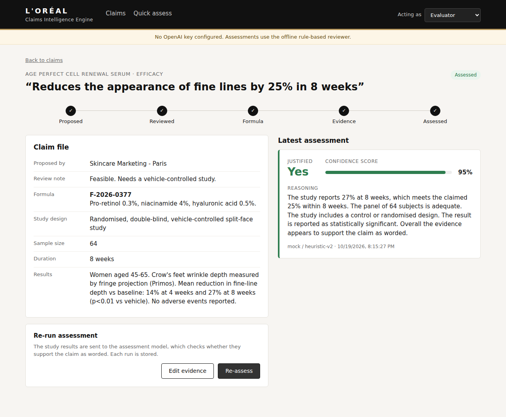
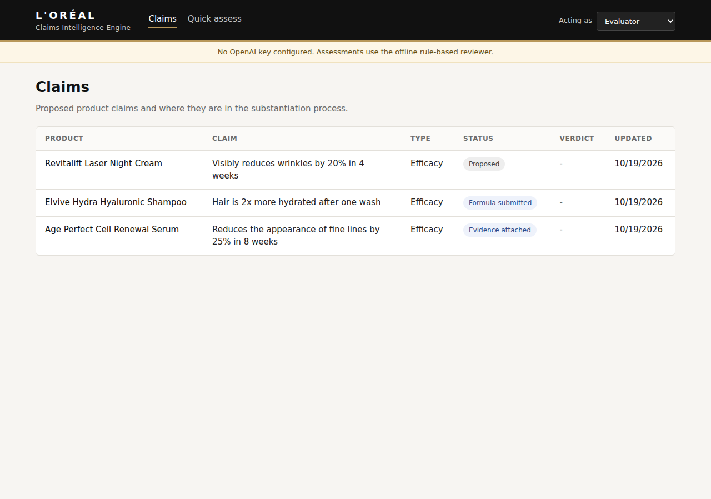
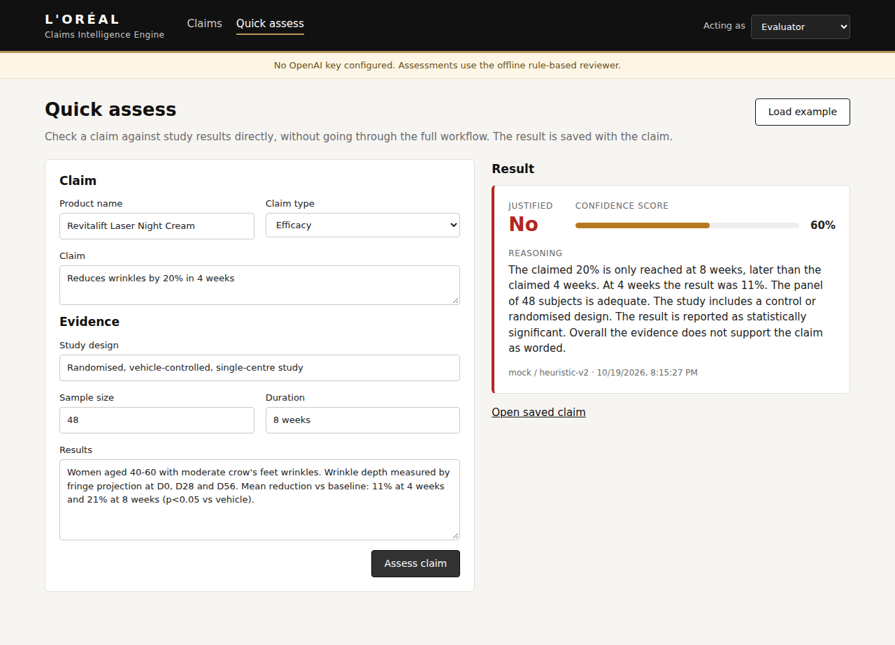
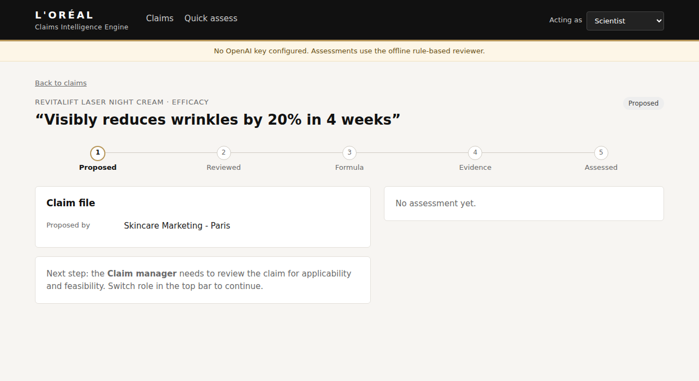

# L'Oréal Claims Intelligence Engine

An evaluator submits a product claim (for example "Reduces wrinkles by 20% in 4 weeks") together with the clinical study results. An LLM checks whether the study supports the claim, the result is saved to the database, and the React UI shows it: **Justified yes/no, confidence score and reasoning**.

It also covers the full business flow: the business team proposes a claim, the claim manager approves it, the scientist submits the formula, and the evaluator attaches evidence and runs the assessment.



## Stack

- **Backend:** NestJS 12, Prisma 7, PostgreSQL 16, OpenAI SDK, zod, Vitest
- **Frontend:** React 19 with Vite, plain JSX and CSS
- **Database:** PostgreSQL via Docker Compose

## Documents

1. [Business process understanding](docs/01-business-process.md)
2. [Research performed](docs/02-research.md)
3. [Technical architecture justification](docs/03-architecture.md)
4. [Product roadmap](docs/04-roadmap.md)

## Prerequisites

| Tool                                                                            | Version                       | Needed for              |
| ------------------------------------------------------------------------------- | ----------------------------- | ----------------------- |
| [Git](https://git-scm.com/)                                                     | any                           | cloning                 |
| [Docker](https://docs.docker.com/get-docker/) (Docker Desktop on Windows/macOS) | with Compose v2               | both options            |
| [Node.js](https://nodejs.org/)                                                  | 22.12 or later (tested on 24) | development option only |

An OpenAI API key is optional. Without one, the app uses a built-in offline reviewer.

Ports used: `8080` (Docker web), `3000` (API), `5173` (Vite dev server), `5433` (PostgreSQL). If one is taken, change it in `docker-compose.yml` or `.env`.

```bash
git clone https://github.com/devsayalir/loreal-claims-intelligence-engine.git
cd loreal-claims-intelligence-engine
```

## Option 1: Run everything with Docker

```bash
cp .env.example .env        # Windows: copy .env.example .env
# Edit .env: set OPENAI_API_KEY and LLM_PROVIDER=openai, or leave as is for offline mode
docker compose up -d --build
```

Open http://localhost:8080. The first build takes a few minutes.

| Task                       | Command                      |
| -------------------------- | ---------------------------- |
| Logs                       | `docker compose logs -f api` |
| Stop                       | `docker compose stop`        |
| Remove containers and data | `docker compose down -v`     |

Compose starts four services:

| Service   | What it does                                                                     |
| --------- | -------------------------------------------------------------------------------- |
| `db`      | PostgreSQL 16                                                                    |
| `migrate` | One-off job that applies migrations and loads demo data if the database is empty |
| `api`     | NestJS on Node 24, started only after `migrate` succeeds                         |
| `web`     | The React build served by nginx, which also proxies `/api` to the API            |

## Option 2: Run for development (hot reload)

### Quick way: scripts (macOS, Linux, WSL or Git Bash)

```bash
./scripts/setup.sh                          # once: checks tools, creates .env files, installs, migrates, seeds
OPENAI_API_KEY=sk-... ./scripts/setup.sh    # same, and enables OpenAI

./scripts/dev.sh                            # starts the database, API and web app. Ctrl+C stops them.
```

`setup.sh` is safe to re-run. It keeps existing `.env` files, and only seeds demo data into an empty database.

### Manual steps

Use three terminals, each starting from the repository root.

```bash
# Terminal 1: database (PostgreSQL on localhost:5433)
docker compose up -d db
```

```bash
# Terminal 2: backend on http://localhost:3000/api
cd backend
cp .env.example .env          # Windows: copy .env.example .env
                              # optional: set OPENAI_API_KEY and LLM_PROVIDER=openai
npm install                   # also generates the Prisma client
npx prisma migrate deploy     # creates the tables
npm run db:seed               # demo data (resets claims each time it runs)
npm run start:dev
```

```bash
# Terminal 3: frontend on http://localhost:5173
cd frontend
npm install
npm run dev
```

Open http://localhost:5173. The startup log of the backend says which provider is active (`Using OpenAI` or `Using the mock provider`).

To browse the database, run `docker exec -it claims-db psql -U claims -d claims`, or run `npx prisma studio` from `backend/`.

### OpenAI or offline mode

Set these in `backend/.env` for development, or in the root `.env` for Docker. Restart the API after changing them.

| Setting                                        | Behaviour                                                                 |
| ---------------------------------------------- | ------------------------------------------------------------------------- |
| `LLM_PROVIDER=openai` and `OPENAI_API_KEY` set | Uses OpenAI (`OPENAI_MODEL`, default `gpt-4o-mini`)                       |
| `OPENAI_API_KEY` empty                         | Falls back to the built-in rule-based reviewer, and the UI shows a banner |
| `LLM_PROVIDER=mock`                            | Always uses the rule-based reviewer                                       |
| `LOG_LLM_PAYLOADS=true`                        | Logs full prompts and model responses (development only)                  |

`GET /api/health` shows which provider is active. If OpenAI returns an error (for example `429 insufficient_quota` when the account has no credits), the API responds with `502` and the reason is in the API log.

### Trying the flow

Use the **Acting as** dropdown in the top bar to switch role.

1. **Business team:** click "New claim".
2. **Claim manager:** open the claim and approve it.
3. **Scientist:** submit the formula.
4. **Evaluator:** attach the study results, then click "Assess claim".

To test the assessment directly, switch to **Evaluator**, open **Quick assess** and click **Load example**.

The seed data includes one claim at each of the main stages.

| Claims list                                      | Quick assess                                       | Waiting on another role                                       |
| ------------------------------------------------ | -------------------------------------------------- | ------------------------------------------------------------- |
|  |  |  |

## API

All endpoints are under `/api`. Write endpoints need an `X-User-Role` header.

| Method | Path                      | Role          | Description                                                |
| ------ | ------------------------- | ------------- | ---------------------------------------------------------- |
| POST   | `/claims`                 | BUSINESS      | Propose a claim                                            |
| GET    | `/claims`                 | any           | List claims (`?status=` filter)                            |
| GET    | `/claims/:id`             | any           | Claim with its assessments                                 |
| PATCH  | `/claims/:id/review`      | CLAIM_MANAGER | `{ decision: APPROVE or REJECT, note }`                    |
| PATCH  | `/claims/:id/formula`     | SCIENTIST     | `{ formulaReference, formulaDetails }`                     |
| PATCH  | `/claims/:id/evidence`    | EVALUATOR     | `{ studyDesign, sampleSize, studyDuration, evidenceText }` |
| POST   | `/claims/assess`          | EVALUATOR     | Assess a claim (see below)                                 |
| GET    | `/claims/:id/assessments` | any           | Assessment history                                         |
| GET    | `/health`                 | any           | Status and active LLM provider                             |

`POST /api/claims/assess` accepts either a stored claim:

```json
{ "claimId": "0ee998bc-a911-4712-a6d0-a626bf9c4d70" }
```

or a claim with its evidence inline:

```json
{
  "claim": {
    "productName": "Revitalift Laser Night Cream",
    "claimText": "Reduces wrinkles by 20% in 4 weeks",
    "claimType": "EFFICACY"
  },
  "evidence": {
    "studyDesign": "Randomised, vehicle-controlled",
    "sampleSize": 48,
    "studyDuration": "8 weeks",
    "evidenceText": "Wrinkle depth: -11% at 4 weeks and -21% at 8 weeks (p<0.05)."
  }
}
```

Response (`201`):

```json
{
  "id": "77649112-20e1-43af-8571-95c452fb794f",
  "claimId": "24630c53-9022-40fb-8ceb-750dc0598fd6",
  "justified": false,
  "confidenceScore": 60,
  "reasoning": "The claimed 20% is only reached at 8 weeks, later than the claimed 4 weeks. ...",
  "provider": "openai",
  "model": "gpt-4o-mini",
  "promptVersion": "claims-v1",
  "createdAt": "2026-10-19T18:07:30.272Z"
}
```

Error responses:

| Status | When                                                              |
| ------ | ----------------------------------------------------------------- |
| 400    | Invalid body                                                      |
| 403    | Wrong role                                                        |
| 404    | Unknown claim                                                     |
| 409    | The claim is not at a stage where it can be assessed              |
| 502    | The model failed or returned an invalid answer. Nothing is saved. |

## Project layout

```
backend/
  prisma/schema.prisma        Claim and Assessment models
  prisma/seed.ts
  src/claims/                 workflow endpoints and status transitions
  src/assessment/             POST /claims/assess
  src/llm/                    provider interface, OpenAI, offline reviewer, prompt
  src/auth/                   role header guard
frontend/
  src/components/AssessmentResult.jsx   verdict, confidence, reasoning
  src/pages/                  claims list, claim detail, quick assess
docs/                         the four written deliverables
docker-compose.yml            db, migrate job, api, web
```

## Tests

```bash
cd backend
npm test
```

## Notes

- Roles come from a request header so the flow can be demoed without a login. This is not authentication.
- Re-running an assessment keeps the previous results. Each run stores the model, the prompt version and the exact evidence text it was given.
