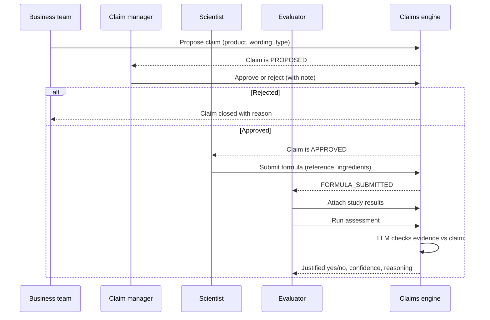
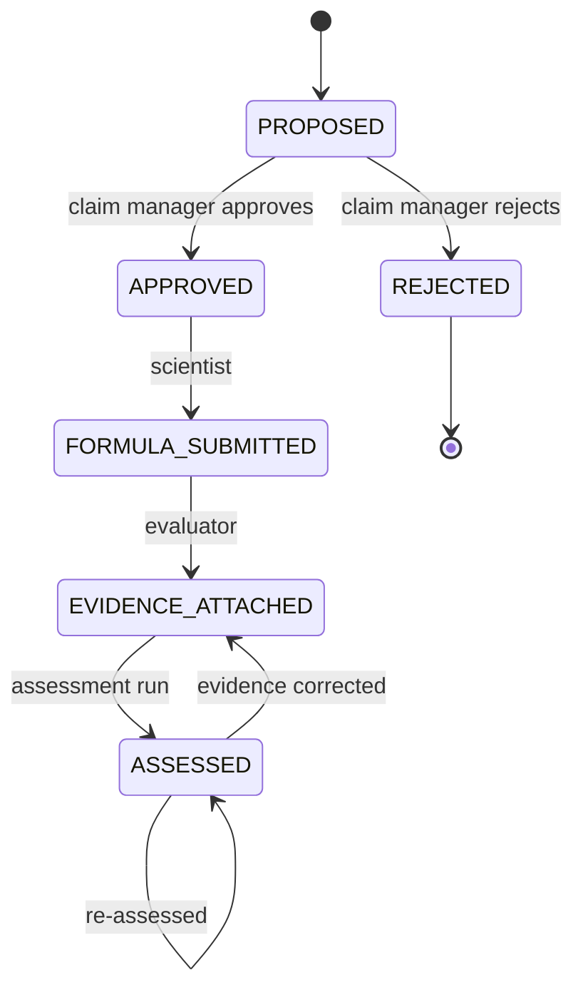

# 1. Business process understanding

## What problem this solves

Every claim printed on a L'Oréal pack ("reduces wrinkles by 20% in 4 weeks", "2x more hydrated hair") has to be backed by evidence before launch. In the EU this is a legal requirement (Regulation (EU) No 655/2013). Other markets such as the US, China and the GCC have their own rules. Today the evidence check is mostly manual. A claims expert reads the study report and compares it line by line against the wording of the claim. This takes time, depends on the person, and the reasoning is often not written down anywhere.

The engine does not replace the expert. It gives the evaluator a first, structured opinion with its reasoning. It also keeps a record of what was checked, against which evidence, and when.

## Actors

| Actor | Responsibility in this app |
| --- | --- |
| Business team (marketing) | Proposes a product and the claim they want to make |
| Claim manager | Decides if the claim is applicable (market, category, regulation) and feasible to prove |
| Scientist (R&I) | Submits the formula that will be tested |
| Evaluator | Attaches the clinical or consumer study results and runs the assessment |

## Flow

## Claim lifecycle

The backend enforces these rules (`backend/src/claims/claim-status.ts`). For example, a scientist cannot submit a formula for a claim that has not been approved, and nobody can assess a claim before evidence is attached.

## What "justified" means here

When a claims expert reviews a study, they mainly check five things:

1. **Magnitude.** Did the study measure at least the claimed effect (20%)?
2. **Timeframe.** Was it measured within the claimed period (4 weeks)? Reaching 21% at week 8 does not support "20% in 4 weeks".
3. **Endpoint.** Does the measurement match the wording? An instrumental wrinkle depth measurement is not the same as a self-assessment questionnaire.
4. **Population.** Does the panel match the target consumer (age, skin type)?
5. **Quality.** Is the panel large enough? Is there a vehicle or placebo control? Is the result statistically significant?

The assessment prompt is built around these checks. The offline rule-based reviewer covers the first two, plus sample size, control and significance.

## Assumptions I made

- One claim is tied to one product and one formula. In reality, one study often supports several claims, and one claim may need several studies. See the roadmap.
- Study results are entered as text. Real study reports are long PDFs.
- Roles are picked from a dropdown. In production they would come from the company SSO.
- The assessment is a recommendation. The evaluator stays accountable for the final decision.
