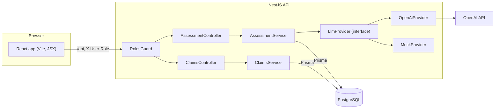
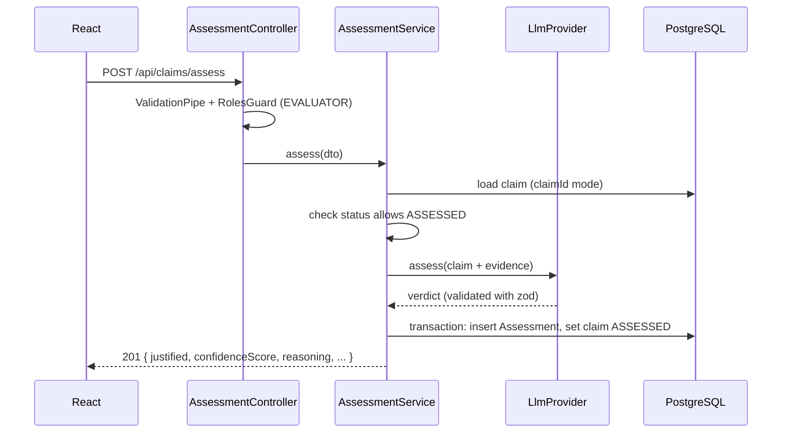

# 3. Technical architecture and justification

## Overview

## The assess request, step by step

`POST /api/claims/assess` accepts two shapes:

- `{ "claimId": "..." }` for a claim that went through the workflow.
- `{ "claim": {...}, "evidence": {...} }`, which is the literal scenario from the brief. The claim is created and assessed in one step.

In both cases nothing is written until the model has answered. A timeout or a bad response returns `502` and leaves no partial records.

## Decisions

### NestJS with feature modules
`ClaimsModule` owns the workflow, `AssessmentModule` owns the LLM call and its storage, and `LlmModule` owns the provider choice. Each module can be tested in isolation, and the controllers are thin. NestJS's dependency injection is what makes the provider swap below a one-line factory.

### An `LlmProvider` interface instead of calling OpenAI directly
- The app runs without an API key (demo, CI, an interviewer's laptop).
- Tests are deterministic and free.
- Moving to Azure OpenAI (likely in a large corporate setup), or adding a second model to cross-check, does not touch the service code.

The mock is not a stub that returns a fixed answer. It is a small rule-based reviewer, so the demo still shows sensible results (`backend/src/llm/mock.provider.ts`).

### Strict JSON schema plus zod validation
The model is forced into `{ justified, confidenceScore, reasoning }` by the API, and the result is validated again on our side. If parsing fails, the call is retried once. The confidence score is clamped to 0-100 and rounded, because the database column is an integer.

### Prisma with PostgreSQL
- The data is relational: claims have many assessments, and the workflow lives on the claim.
- Prisma gives typed queries and readable migrations, and the schema file doubles as documentation.
- PostgreSQL `jsonb` stores the raw model response for audits without a separate document store.

### What is stored with each assessment, and why

| Field | Reason |
| --- | --- |
| `justified`, `confidenceScore`, `reasoning` | The result the brief asks for |
| `evidenceSnapshot` | The exact text sent to the model. Evidence on the claim can change later. |
| `provider`, `model`, `promptVersion` | Explains why two runs might differ |
| `rawResponse` | Full model response, for debugging and audits |

### Status machine on the server
The transition table lives in a single place, and every write goes through it. The UI only decides which form to show. The API is the source of truth, so a tool like curl cannot skip steps either.

### Roles via a header
A real SSO integration was out of scope for a one-day task. The `RolesGuard` reads `X-User-Role` and checks it against `@Roles(...)` on each endpoint. Swapping it for JWT claims later only changes the guard, not the controllers.

### React (Vite, plain JSX)
The brief asks for JSX. I used no UI library and no state library: three pages, a small `fetch` wrapper, a role context and plain CSS. `AssessmentResult.jsx` is the component requested in the brief. The Vite dev server proxies `/api` to the backend, so no CORS setup is needed locally.

### Synchronous assessment
A call to `gpt-4o-mini` with this prompt size takes a few seconds, so a synchronous request with a 30s timeout is acceptable for one evaluator clicking a button. For batch runs or long PDF reports this should move to a queue. See the roadmap.

## Testing

- `claim-status.spec.ts` covers the transition table.
- `mock.provider.spec.ts` covers the offline reviewer rules, including results that reach the number only after the claimed timeframe.
- `assessment.service.spec.ts` covers both request shapes, the 404, 409 and 400 cases, the 502 path with no DB write, and the audit fields.

## Known limitations

- There is no real authentication.
- Evidence is plain text, with no PDF upload.
- There is no rate limiting or cost cap on LLM calls.
- The confidence score is not calibrated.
