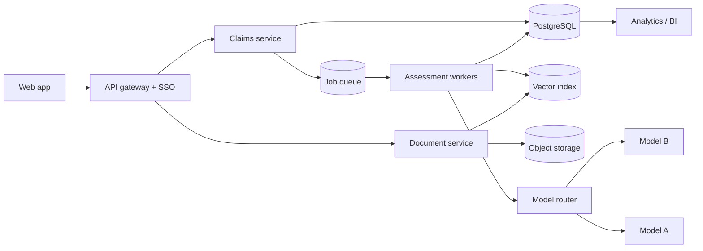

# 4. Product roadmap

This is where I would take the product with more time and no constraints on the design. It is grouped by horizon, and each item says what it unlocks.

## Phase 1: Production-ready (0-3 months)

- **SSO and real roles.** Use Azure AD or Okta, with JWT claims mapped to roles, and scope access by brand, division and market.
- **Audit trail.** Add an append-only event table (who did what, when, from which state). Export to PDF for regulatory files.
- **Human override.** The evaluator can accept or override the AI verdict, and an override requires a written reason. These overrides become the most valuable training and evaluation data.
- **Document upload.** Accept PDF study reports, extract text, and keep the original file in object storage. Store a hash of each file in the DB.
- **Async processing.** Run assessments as queued jobs with retries, show a status in the UI, and send notifications when done.
- **Cost and safety controls.** Add per-user rate limits, token budgets, PII redaction before sending data out, and a private endpoint (Azure OpenAI in an EU region).

## Phase 2: Better answers (3-9 months)

- **Evidence-grounded reasoning.** Chunk long study reports and retrieve the relevant tables and sections (RAG). The model must quote the passage it relied on, and the UI highlights it in the source document.
- **Evaluation set and regression tests.** Build a few hundred past claims with the expert decision. Every prompt or model change runs against this set in CI, and accuracy and false-positive rate are tracked over time.
- **Calibrated confidence.** Map the model score to observed accuracy on the evaluation set, so "80%" really means right 8 times out of 10.
- **Second-opinion mode.** Two different models assess independently. A disagreement goes straight to a senior expert.
- **Market rule packs.** Encode EU, US (FTC/NAD), China (NMPA) and GCC rules as structured checks. The same claim gets a verdict per target market.

## Phase 3: Claims intelligence (9-18 months)

- **Claim wording assistant.** Suggest the strongest wording the evidence supports. For example: "the study supports 'reduces wrinkles by 15% in 4 weeks' or '20% in 8 weeks'".
- **Evidence library.** Turn every study into a reusable asset. When marketing proposes a new claim, the system looks for existing studies that already support it, before anyone commissions a new one.
- **Study design advisor.** For a target claim, propose the panel size, endpoints, instruments and timepoints needed to substantiate it.
- **Portfolio analytics.** Track claim approval rates by category and market, time from proposal to approval, common rejection reasons, and the share of claims at risk when a regulation changes.
- **Regulatory watch.** Monitor regulation updates and flag live claims that are affected.

## Architecture evolution

## How I would measure success

- Time from evidence attached to decision goes down.
- Agreement between the AI verdict and the final expert decision goes up on the evaluation set.
- No claim approved through the tool is later challenged for lack of evidence.
- Evaluators use the tool by choice: track weekly active evaluators and the override rate.
